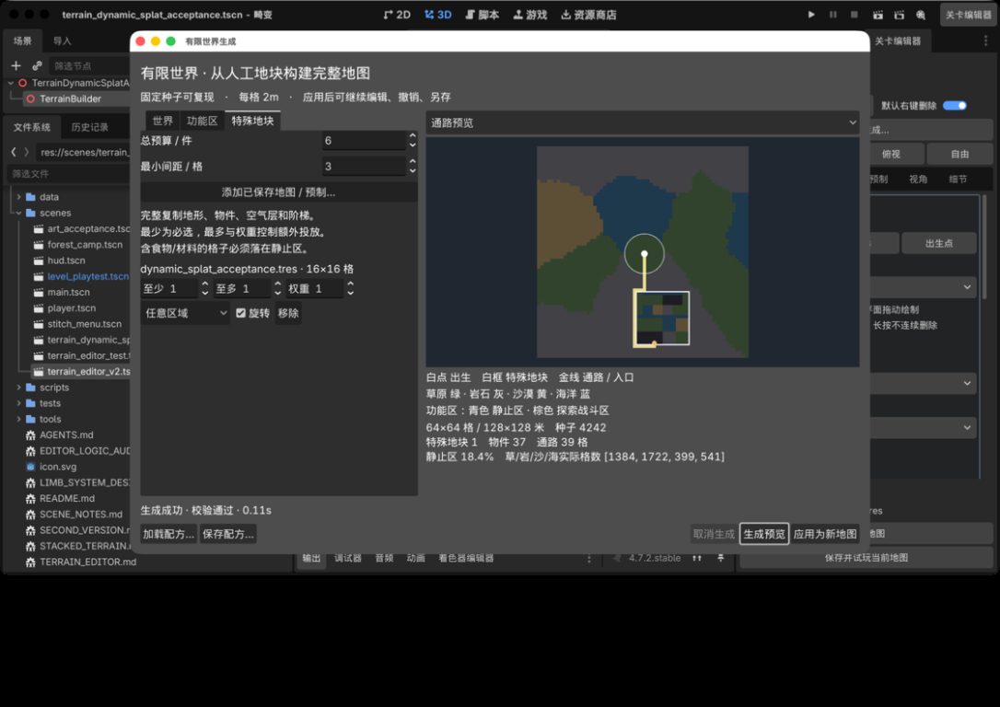
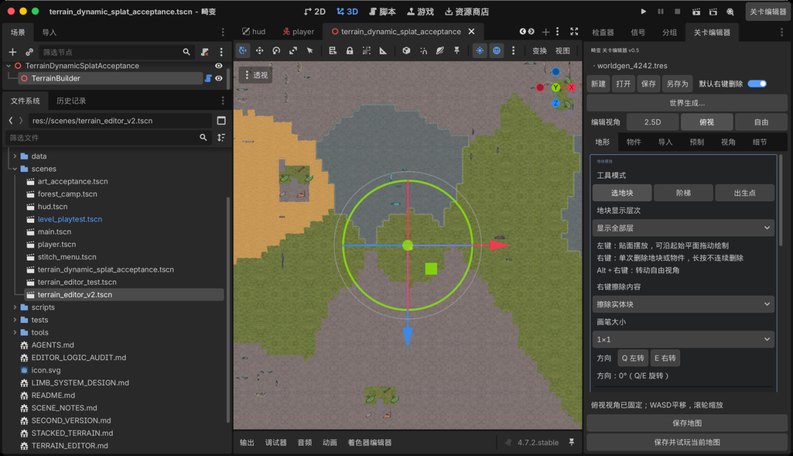

# 有限世界生成：方案、操作与验收

已实现，更新日期：2026-10-18。当前固定视角物件朝向修复分支：`fix/worldgen-fixed-view-rotation`，算法版本为 4。

入口：Godot 顶部 **关卡编辑器 → 文件操作区下方「世界生成…」**。生成窗口包含「世界 / 功能区 / 特殊地块」三页，右侧显示全图预览。生成成功后应用为新的未保存地图，再通过原编辑器继续编辑和另存。

## 目标与依据

在现有关卡编辑器中把手工保存的 LevelData 地图、LevelPrefab 作为特殊地块，固定种子一次生成完整的有限世界，保存后仍能继续编辑。

依据：用户参考图（出生核心、探索战斗区、时间静止区、Smoothstep 距离衰减、资源簇及最小间距）、`../畸变.mm`、`../2m单元格_4K场景素材绘制规格.xlsx`、`/Users/bytedance/Downloads/畸变_场景机制设计.xlsx`。游戏框架 Word 主要是角色系统截图；旧尺寸 Word 只作背景，不覆盖新版表格。

参考 [Klei 社区 worldgen 指南](https://kleiforums.com/forums/topic/48070-guide-intro-to-worldgen/) 的任务、房间和连接组织方式；本实现采用适合现有格子编辑器的数据算法，并非饥荒源码移植。

## 算法选择

采用组合式生成，而非单一噪声或全图 WFC：

1. **确定性随机数**：私有 RandomNumberGenerator，固定种子、参数、资源内容得到相同结果，记录算法版本。
2. **生态分区**：分散种子点、按权重分配生态，用平滑噪声扰动 Voronoi 边界。生态权重影响分区数量，不承诺严格面积配额；预览显示实际面积。
3. **功能区**：出生核心强制探索区；在外围选时间静止核心，用 Smoothstep 控制中心到边缘的影响，低频噪声使边界自然且保持成片。功能区与草原/岩石/沙漠/海洋生态是两套正交标签。
4. **特殊地块**：受有限边界、间距、区域、次数及旋转约束，先投放地块再铺通路、最后生成散布物。复用 LevelPrefab 的整体验证、旋转和支撑关系处理。地图源只读，已有出生点不复制。固定相机卡片、投射盒/楔和墙面图不能四向旋转；来源包含这类伪 3D 物件时自动保持作者方向，只有贴地资源和真正多面资源允许随地块旋转。默认从矩形边界对全空列做四邻接 flood fill，将连通的未绘制外缘视作透明，沿用大地图原有地形；封闭的内部孔洞、海水与实体列中的空气层保持作者设计。每个来源可以关闭「融合外缘」，恢复完整复制空格的行为。
5. **高度和通路**：默认启用「地面齐平」，将特殊地图最常见的合法外围地面整体对齐到世界第 1 层；本次三张源地图均整体上移 1 层（2m）。地形、物件、墙面附件、阶梯和细节锚点同时平移，源地图内部高差和空气层不变；抬升时下方沿用世界基底，完全空的内孔仍为空。下降时只允许移除底部空气槽，若会裁掉原有实体则拒绝。最大层数也必须满足现有格式限制。从出生点连接各入口，使用最小生成树和 AStarGrid2D 四邻接寻路，海水通路转换为岩地。关闭「地面齐平」后保留原高度，第 0～2 层的入口可通过阶梯连接。
6. **资源**：按区域、生态、密度及簇间/簇内间距采样，再交给 ObjectRules 校验支撑、碰撞及占地。建筑材料和食物仅在静止区散布；宝箱和环境机制按各自配置生成。固定视角资源保持美术定义的原始朝向，不再随机产生 90° 侧面；贴地和多面资源仍可随机四向旋转。特殊地块中违反此限制的采集物也必须约束所属区域。
7. **验证**：地图数据/物件规则、出生点、特殊地块数量、越界重叠、入口可达性、保存重载一致性。必选内容失败时不产生可应用的半成品。

全图 WFC 需要大量邻接样例，难以直接约束完整人工地图与入口，先不引入。BSP 容易呈现矩形房间结构，与开放生态不符；简单独立随机点会产生区域碎片。

## UI 和操作

- 入口：关卡编辑器文件操作区下方的“世界生成…”按钮，保留现有页签顺序。
- 独立可调整窗口：左侧参数页签，右侧全图预览、图例和生成报告，底部生成/取消/应用按钮。
- 参数：种子和换种子；宽高（格及米）；生态区域数、边界起伏、四类生态权重；出生半径；静止区核心数量、半径、衰减距离；特殊地块总预算、间距及逐项最少/最多/权重/区域/旋转；资源与环境物件密度、簇间距。
- 来源：从项目选择 `.tres`，接受 LevelData 或 LevelPrefab；清楚显示资源名、尺寸和约束。不会自动把用户所有地图投放进去。
- 配方：保存/加载生成设置，特殊地块以资源路径引用。
- 预览：生态/功能区/通路图；出生点、特殊地块框、入口和连接线；显示实际尺寸、数量、区域面积和警告。参数变化后标记旧预览失效，必须重新生成才能应用。
- 应用：创建新的未保存 LevelData，通过编辑器撤销管理器切换地图；不会直接写回当前地图路径。可按原流程另存、编辑和试玩。
- 生成在工作线程执行，主界面显示状态，可请求取消；只有完整成功结果能应用。

## 快速操作

1. 打开「关卡编辑器」，点击「世界生成…」。首次使用可保留 64×64 格、种子 20261018，先生成纯地形。
2. 到「特殊地块」点击「添加已保存地图 / 预制…」，选择项目内的 `LevelData` 或 `LevelPrefab` `.tres`。源地图必须先保存。
3. 设置每种地块的最少、最多、权重、区域、旋转、「融合外缘」和「地面齐平」。两项拼接设置默认开启。最少为必选数量，先于按权重选择的额外数量投放；总预算不能小于全部必选数量。允许旋转时使用四个直角方向；若来源含固定视角物件，控件会显示「固定朝向」并自动锁定。刻意设计的外缘深坑可关闭融合；需要保留绝对层级时可关闭齐平。
4. 点击「生成预览」，查看实际生态面积、物件数量、警告和通路。白点为出生点，白框为特殊地块，金色为通路及入口；下拉框切换生态、功能区、通路视图。
5. 不满意时修改参数或换种子后重新生成。修改参数、加载配方或取消生成都会使旧结果不可应用。
6. 点击「应用为新地图」，窗口关闭，结果进入现有 3D 编辑器。原生撤销/重做支持这次切换，并恢复相应地图的保存路径。
7. 点击「另存为」保存结果。后续通过原编辑器「打开」读取，操作方式与手工地图一致。
8. 「保存配方…」仅保存生成参数和源资源路径；「加载配方…」恢复参数后需要再次生成。它与地图保存是两项独立操作。

特殊地块须有一个未被物件或阶梯占用的边缘实体格作为入口，顶面位于第 0～2 层。开启融合时，实际地形与外缘空白交界处也可以作为入口，不要求把地形一直画到保存地图的矩形边界；通路可以通过已融合的外缘。关闭融合时仍要求原矩形边缘存在入口。无可用入口、必选预算超限、尺寸或功能区约束无法满足时会显示具体原因。优先扩大世界/静止区、减少必选数量或间距，再更换种子。每份地块最多尝试 100 个候选位置，失败不代表数学上不存在任何布局。

源地图以私有副本参与生成，已有出生点不复制；手工地形、空气层、海水、贴花、阶梯、物件及其支撑关系、细节沿用 `LevelPrefab` 的投放规则。普通「预制」工具仍完整复制矩形空格与原高度，只有世界生成执行外缘融合和整体高度对齐。内部相对高差保留，不抹平作者的高台。

## 可调参数

距离默认以格计，1 格 = 2 米。生态与功能区分别计算，例如草原可以同时属于静止区或探索战斗区。

| 页签 | 参数 | 默认值 / 范围与含义 |
| --- | --- | --- |
| 世界 | 种子 | 默认 20261018；UI 可输入 0～2147483647，或随机换种子 |
| 世界 | 宽、高 | 默认 64×64；各 16～600 格，实时显示米数与格数 |
| 世界 | 生态区域数 | 默认 12，1～64；控制 Voronoi 种子点数量 |
| 世界 | 边界起伏 | 默认 0.22，0～1；扰动生态边界 |
| 世界 | 草、岩、沙、海权重 | 默认 4:3:2:1；至少一项大于零，影响生态种子分配 |
| 功能区 | 出生核心半径 | 默认 6；强制陆地、探索区且不散布物件，须小于短边一半减 1 |
| 功能区 | 静止核心数、半径、距离衰减 | 默认 3 / 9 / 8；控制静止区覆盖及边缘过渡 |
| 功能区 | 采集物、环境物件密度 | 默认 6 / 3 件每千格；各 0～50，是目标而非强制数量 |
| 功能区 | 资源簇间距、簇内物件间距 | 默认 9 / 2；控制散布锚点间距，占地仍接受完整碰撞校验 |
| 特殊地块 | 总预算、最小间距 | 默认 6 件 / 3 格；预算最多 32，间距至少 1 |
| 特殊地块 | 各来源最少 / 最多 / 权重 | 新加入默认 1 / 1 / 1；权重为零仍会投放必选数量 |
| 特殊地块 | 区域、旋转 | 默认任意区域；纯地形、贴地和多面资源允许旋转，含固定视角物件时自动锁定作者方向 |
| 特殊地块 | 融合外缘 | 默认开启；边界连通的全空列保留世界地形，关闭则完整保留原图空格；配方字段为 `blend_edges` |
| 特殊地块 | 地面齐平 | 默认开启；整体平移常见外围地面到世界第 1 层，内部高差保留；配方字段为 `align_height` |

含材料、果树或遗骸的特殊地块，即使选择「任意区域」，这些采集物占地也必须处于静止区。自动散布使用项目中符合规则的 `scene1016_*` 机制资产，不自动散布贴墙载体。密度、生态、区域与碰撞约束会共同降低实际数量，报告中说明未达目标的情况。

## 实现位置与样例

| 文件 | 职责 |
| --- | --- |
| `scripts/worldgen/world_gen_config.gd` | 参数资源、输入校验和配方快照 |
| `scripts/worldgen/world_generator.gd` | 独立随机数、生态与区域、完整地块投放、通路、散布与最终校验 |
| `addons/terrain_editor/world_gen_dialog.gd` | 参数窗口、线程、取消、文件选择、配方和生成报告 |
| `addons/terrain_editor/world_gen_preview.gd` | 三种全图预览、入口、地块边界与格子提示 |
| `addons/terrain_editor/terrain_editor_plugin.gd` | 入口、目标场景检查、原生 UndoRedo 地图切换 |
| `scripts/level/level_data.gd` | `generation` 元数据的保存、复制、快照与恢复 |

可直接尝试：

- [三种特殊地形齐平配方](../data/worldgen_three_landmarks_recipe.tres)及[修复后的齐平地图](../data/levels/generated_special_world_aligned.tres)：种子 1692031905，64×64 格，3 个特殊地形、37 个物件、100 格通路；三个源地图的 363 个外缘空格均不再清空世界地形，三处入口与大地图均为第 1 层。详细操作见[复现场景](world_generation_reproduction.md)。
- [生成地图 worldgen_4242.tres](../data/levels/worldgen_4242.tres)：64×64 格，种子 4242，包含 3 份 `demo_camp`，55 个物件、121 个通路格。已通过 GUI 另存和重新打开。
- [保存地图嵌入配方](../data/worldgen_saved_map_recipe.tres)：种子 4242，64×64 格，嵌入一份 16×16 的 `dynamic_splat_acceptance.tres`，本次生成 37 个物件、39 个通路格。此配方示范直接使用已保存的 LevelData，与上述营地地图是两个样例。

以下两张为初版 Computer Use 截图，已保存的历史地图不会自动重生成；使用版本 4 配方生成时，固定视角散布物的朝向及后续随机序列可能变化：





## 接缝问题修复

初版应用后，特殊地图的外围空格会把生成地面清掉，露出编辑器网格。这是拼接缺陷，先前把它解释为需要保留的正常结果不准确。

已通过 Computer Use 使用种子 1692031905 和三个源地图点击生成、应用，复现旧版空白带；新版再次实际生成、应用、撤销及重做。算法只恢复外部连通的全空列，不填内部孔洞或分层空气，并在融合后重新执行地图校验。

第二次检查发现：只补外围空格仍不够，源地图第 0 层地面会低于大地图第 1 层。已补充整体高度对齐，并实际点击生成、应用检查草地与沙地接缝；外围下陷崖壁消失，中央高台仍高于基础地面 2m。数据检查确认三张特殊地图入口均与世界同高。

`tests/test_worldgen_seams.gd` 已补充整体平移、基底、物件/阶梯/细节锚点、最大层级与裁剪保护；原有 29 项世界生成测试通过。编辑器套件 20 项通过，覆盖融合与齐平开关、预览失效、配方持久化、真实应用高度及撤销重做。

实际 Computer Use 截图：


历史对照：[初版空隙](images/worldgen_seams/before_full.png)、[只补空隙但仍低一层的中间结果](images/worldgen_seams/after_closeup.png)。这些是旧版/中间结果，不代表当前版本验收。

旧成品 `final_generated_special_world_64.tres` 和中间结果 `generated_special_world_blended.tres` 保留作对照；日常使用 `generated_special_world_aligned.tres` 或重新生成。旧配方缺少 `blend_edges` / `align_height` 时，均按默认开启处理；算法版本变化意味着同种子不承诺与版本 1 或 2 逐格相同。

## 数据边界

- LevelData 仍是唯一地图格式；新增生成元数据包含配方、功能区、地块位置、通路与版本，参与复制、快照、保存和撤销。
- 世界生成器不依赖 EditorPlugin；参数、算法、预览和插件桥接分别实现。
- 每格 2 米，当前地图上限 600×600 格（1200×1200 米）。参考图的 2700×2700 米需 1350×1350 格，超过当前地图格式与渲染验收范围；本次不无依据扩容。
- 默认 64×64 格用于编辑器迭代，出生半径和静止区半径默认按这个尺度设置；扩大宽高不会自动放大半径，应同时调整功能区尺寸。600 格世界沿用默认小静止区时，可采集物的实际数量会明显不足。
- 每轮自动散布最多 160 个采集物、160 个环境物件，不含特殊地块自带物件；触及上限会显示警告。这是现有物件校验与编辑器重建开销的保护，不代表已支持最大尺寸的高密度世界。
- 生成使用工作线程，应用到真实 3D 场景仍由现有 TerrainBuilder 在主线程完整重建，可能短暂阻塞。全图规划使用生成窗口的预览；编辑视口受现有缩放上限限制，可平移检查局部。
- 时间静止区在本轮是生成与资源分配标签，不等于已经实现正式战斗计时暂停、NPC 任务、AI 或肢体能力导航。
- 通路保证按普通地面/阶梯到达指定入口；特殊地块内部的机关、跳跃与能力门槛由作者设计，不自动改写。
- 程序陆地当前使用统一第 1 层顶面，海洋为岩石海底加独立水层；特殊地块默认整体齐平并保留相对分层高度。没有新增全图山脉起伏、道路专用美术、河流或环路密度参数。
- 生成元数据保留生成当时的区域、通路与配方。后续手工扩图或修改地形不会自动重新计算这些标签，不能直接当作已维护好的运行时导航。

## 验收结果

环境：Godot 4.7.2，macOS，Apple M5 Pro，Metal 4 / Forward+。

| 检查 | 结果 |
| --- | --- |
| `tests/test_world_generation.gd` | 29 项通过：确定性、更换种子、功能区与海底、保存重载、元数据独立复制、旋转完整性、源预制不变、直接使用保存地图、失败与取消 |
| 不同尺寸与种子 | 16×16、48×24、128×96，各种子 0 / 42 / 2147483647 通过 |
| `tests/editor_world_generation_checks.gd` | 20 项通过：真实工作线程、预览、3D 节点、拒绝应用、齐平高度、原生撤销重做、保存路径保留、过期撤销保护、参数失效、两项拼接设置和配方、取消 |
| 既有地图回归 | `test_level_data.gd`、`test_free_blocks.gd` 通过 |
| 完整编辑器回归 | `--test-v2-editor` 通过，包含既有 31 项场景物件编辑器摆放检查 |
| Computer Use | 真实入口、输入种子、添加预制及保存地图、生成、功能区/通路切换、配方保存加载、应用、撤销重做、另存和重开通过 |
| 图形检查 | 64×64 生成世界实际 Metal 渲染、营地、草/岩/沙/海及海水物件可见；没有新增脚本错误 |
| 源文件保护 | 最终 GUI 检查前后，原有 3 个用户修改文件及直接嵌入的保存地图 SHA-256 一致 |

修复并复测了预览颜色类型、Retina 界面重复缩放和中文字体、文件选择器主题、应用被拒绝却显示成功的问题。原生子窗口关闭时 Computer Use 偶有 AX 失效报告，均通过重新获取当前窗口确认实际动作结果。

数据生成抽样耗时（默认种子、无特殊地块，含散布与校验，单次测量）：

| 尺寸 | 数据生成耗时 | 物件数 | 说明 |
| --- | --- | --- | --- |
| 128×128 | 0.277 秒 | 92 | 默认静止区约束使采集物少于目标 |
| 600×600 | 3.507 秒 | 168 | 触发散布上限，静止区仍为默认尺寸；进程静态内存约 638 MiB |

GUI 64×64 含一份保存地图的生成预览约 0.11～0.12 秒，含三份营地约 0.16 秒；应用后数秒内可操作。数据耗时不包括最大尺寸的 3D 完整重建，**600×600 满图渲染和高密度玩法尚未验收**。

复现主要测试：

```sh
../godot-engine/Godot.app/Contents/MacOS/Godot --headless --path . --script tests/test_world_generation.gd
../godot-engine/Godot.app/Contents/MacOS/Godot --headless --editor --path . -- --test-worldgen-editor
../godot-engine/Godot.app/Contents/MacOS/Godot --headless --editor --path . -- --test-v2-editor
```

本次日志位于 `/tmp/aberration-worldgen-{tests,editor-tests,v2-regression,profile,ui-final}.log`。完整编辑器回归里的两条 `missing_directory_for_save_test` 保存失败是既有失败路径测试；GUI 日志中的 macOS `NSURLIsPackageKey` 提示发生在新建配方文件保存之前，之后保存成功并已实际重载。

保留开始时已有的 `data/levels/objects_acceptance.tres`、`data/prefabs/demo_camp.tres`、`scenes/terrain_editor_v2.tscn` 修改。初版已通过 PR #7 合并；本轮接缝修复尚未提交、合并或推送。
