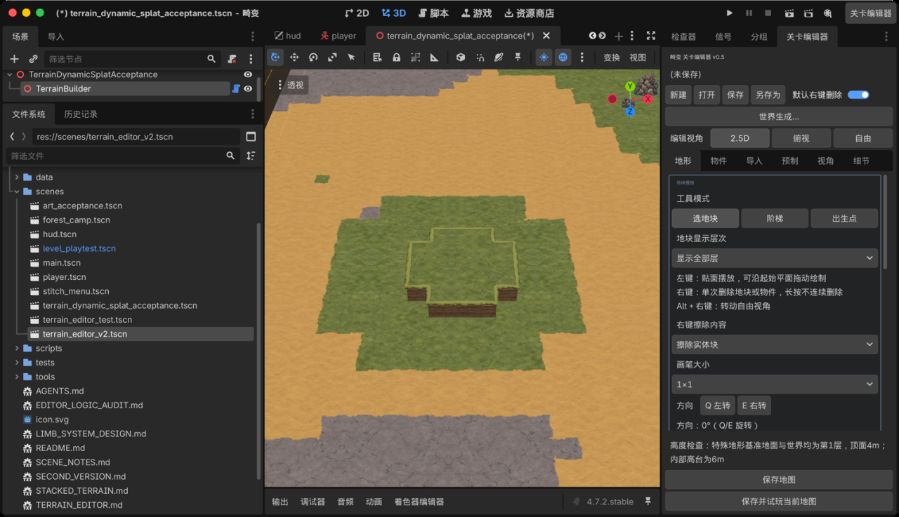
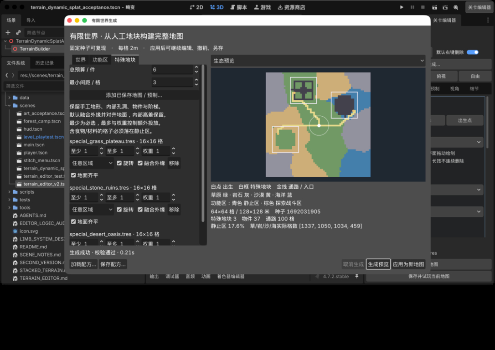

# 世界生成器：策划使用说明

适用版本：包含提交 `05e4da4` 的版本

建议环境：Godot 4.7.2
更新时间：2026-10-18

## 1. 这个功能能做什么

世界生成器可以把策划制作并保存的小地图作为“特殊地形”，自动放进一张有限大小的完整地图中。

生成器会自动完成：

- 生成草原、岩石、沙漠和海洋区域。
- 生成出生点、探索战斗区和时间静止区标签。
- 投放营地、遗迹、绿洲等手工特殊地形。
- 保留特殊地形内部的高台、孔洞、海水、阶梯和物件。
- 让特殊地形外围和大地图自然衔接、高度齐平。
- 连接出生点和各特殊地形入口。
- 按密度散布采集物和环境物件。
- 生成一张仍可继续手工编辑和保存的地图。

## 2. 最快体验方式

项目中已经准备了一套包含“草原高台、石板遗迹、沙地绿洲”的示例配方。

1. 打开 Godot 项目。
2. 点击顶部 **「关卡编辑器」**。
3. 在右侧点击 **「世界生成…」**。
4. 点击窗口底部 **「加载配方…」**。
5. 选择 `res://data/worldgen_three_landmarks_recipe.tres`。
6. 点击 **「生成预览」**。
7. 生成成功后点击 **「应用为新地图」**。
8. 回到地形编辑器，点击 **「另存为」** 保存最终地图。

这套配方会生成一张 64×64 格的地图，包含 3 个特殊地形。

## 3. 标准工作流程

### 第一步：制作特殊地形

使用现有地形编辑器制作一张小地图，例如：

- 营地
- 遗迹
- 绿洲
- Boss 区域
- 剧情场景
- 资源点
- 机关区域

制作完成后，使用 **「另存为」** 将它保存成独立的 `.tres` 地图。

建议：

- 常用尺寸为 8×8、12×12 或 16×16 格。
- 地图边缘或可见地形边缘至少保留一个可进入的实体格。
- 不要用大型物件和阶梯堵住所有入口。
- 内部孔洞、深坑、高台和海水可以正常保留。
- 不需要在特殊地形中设置玩家出生点，最终世界会统一生成出生点。

### 第二步：打开世界生成器

点击：

**顶部「关卡编辑器」→ 右侧「世界生成…」**

窗口结构：

- 左侧：世界、功能区、特殊地块参数。
- 右侧：地图预览和生成报告。
- 底部：加载配方、保存配方、生成、取消和应用按钮。

### 第三步：设置地图规则

完成“世界”“功能区”和“特殊地块”三页设置。参数含义见后文。

### 第四步：生成并检查预览

点击 **「生成预览」**。

只有显示 **「生成成功 · 校验通过」** 后，才能应用地图。参数发生变化后，旧预览会自动失效，需要重新生成。

### 第五步：应用并保存地图

1. 点击 **「应用为新地图」**。
2. 在 3D 编辑器中检查地形、物件、海水和高差。
3. 点击 **「另存为」**，使用新的文件名保存。
4. 不要覆盖作为输入使用的特殊地形源文件。

## 4. “世界”页怎么设置

### 随机种子

种子决定本次随机结果。

- 相同版本、相同种子、相同参数和相同特殊地形，会得到相同结果。
- 想复现一张地图时，记录并固定种子。
- 想换一种布局时，修改种子或点击 **「换一个种子」**。

### 宽 / 高

单位为格，每格是 2×2 米。

| 设置 | 实际范围 | 用途 |
| --- | --- | --- |
| 32×32 | 64×64 米 | 快速实验 |
| 64×64 | 128×128 米 | 当前推荐正式工作尺寸 |
| 96×64 | 192×128 米 | 已验证混合世界构建、碰撞与刷怪 |
| 更大尺寸 | 更大地图 | 按实际物件密度与楼层测试 |

2026-10-18碰撞修复后，地形按8×8区块及高度层合并物理体，默认64×64/96×64混合生成地图的碰撞对象为472/571，96×64已通过Metal运行。600×600满图和高密度动态场景仍需专项验收。

### 生态区域数

决定地图被切分成多少块生态区域。

- 数值较小：区域更大、更完整。
- 数值较大：草、岩、沙、海交错得更频繁。
- 64×64 地图建议使用 `8～16`。

### 边界起伏

控制生态边缘的自然程度。

- `0`：边界较规整。
- `0.2～0.35`：通常比较自然。
- 越接近 `1`：边缘越破碎。

### 草原 / 岩石 / 沙漠 / 海洋权重

权重表示四种生态出现的相对机会，不是严格百分比。

例如 `4 / 3 / 2 / 1` 表示草原最多、海洋最少。将某项设置为 `0`，一般不会为它分配独立生态区域。

## 5. “功能区”页怎么设置

生态和功能区是两套不同规则。草原可以是探索区，也可以是时间静止区。

### 出生核心半径

控制出生点周围的安全净空。

该范围会：

- 保证为陆地。
- 不自动摆放资源和环境物件。
- 避免特殊地形压住出生点。

64×64 地图推荐使用 `5～8`。

### 静止核心数 / 静止核心半径 / 距离衰减

三项一起决定时间静止区的数量、大小和边缘形状。

静止区目前主要用于世界生成和资源分配标签，尚不代表正式游戏中的计时暂停逻辑已经完成。

### 采集物 / 千格

控制果树、材料等采集物的目标密度。采集物只会自动散布在时间静止区。

### 环境物件 / 千格

控制非采集类场景物件的目标密度。

实际数量还会受到生态、区域、物件占地、碰撞和间距影响，因此可能低于目标值。

### 资源簇间距 / 簇内物件间距

- 资源簇间距：不同资源群之间的距离。
- 簇内物件间距：同一资源群内部物件之间的距离。

间距越大，分布越稀疏；间距过小可能因为物件占地冲突而放置失败。

## 6. “特殊地块”页怎么设置

点击 **「添加已保存地图 / 预制…」**，选择已经保存的 `.tres` 地图或预制。

### 总预算

本轮最多投放多少份特殊地形。

系统会先满足所有“至少”数量，再根据权重分配剩余预算。

示例：

- 总预算：6
- 三种特殊地形都设置“至少 1、至多 1”
- 最终仍只会出现 3 份，因为每种最多只能出现 1 份

### 最小间距

控制不同特殊地形之间至少间隔多少格。

64×64 地图放置多个 16×16 特殊地形时，建议使用 `2～4`。数值过大可能找不到合法位置。

### 至少 / 至多 / 权重

- **至少**：必须投放的数量。
- **至多**：最多允许出现的数量。
- **权重**：分配额外预算时被选中的相对机会。

“至多”不能小于“至少”。权重为 0 时仍会满足“至少”数量，但不会获得额外投放。

### 区域

可以选择：

- 任意区域
- 探索战斗区
- 时间静止区

如果特殊地形中包含食物、材料等采集内容，建议直接指定为 **「时间静止区」**。

### 旋转

开启后，特殊地形可以按 0°、90°、180°、270° 旋转投放。地形、阶梯、物件和入口会一起旋转。

如果特殊地形中包含固定相机绘制的伪 3D 物件，系统会自动显示 **「固定朝向」** 并禁用旋转，避免树木、宝箱等物件侧面对着相机而变成纸片。贴地资源和真正具有多面贴图的物件仍可正常四向旋转。

### 融合外缘

建议默认开启。

开启后，特殊地图外围没有绘制的空白不会挖掉大地图地面；内部刻意制作的孔洞和深坑仍会保留。

只有当外围空白本身就是玩法设计，例如孤岛隔离带或外围深坑时，才关闭该选项。

### 地面齐平

建议默认开启。

开启后，特殊地图的基础地面会自动和大地图地面齐平，内部高台和高差保持不变。物件、阶梯和细节也会一起移动。

只有当特殊地形必须保留绝对层级时，才关闭该选项。

## 7. 怎么看生成预览

右侧可以切换三种视图：

### 生态预览

查看草原、岩石、沙漠和海洋的分布。

### 功能区预览

查看探索战斗区和时间静止区的覆盖范围。

### 通路预览

- 白点：玩家出生点。
- 白框：特殊地形范围。
- 金线：出生点与特殊地形入口之间的通路。

生成报告会显示地图尺寸、种子、特殊地形数量、物件数量、道路格数和静止区覆盖比例。

预览通过后仍要点击 **「应用为新地图」**，再在真实 3D 编辑器中检查高度、边壁和物件。

## 8. 配方和地图有什么区别

### 保存配方

配方只保存：

- 随机种子
- 世界和功能区参数
- 特殊地形文件路径
- 数量、区域、旋转和拼接规则

配方不是最终地图。加载配方后仍要重新点击 **「生成预览」**。

### 另存地图

地图保存的是本次已经生成完成的实际地形和物件，可以继续编辑和进入游戏使用。

推荐文件命名：

- 配方：`森林遗迹_世界配方.tres`
- 特殊地形：`森林遗迹_特殊地形.tres`
- 最终地图：`森林遗迹_世界_001.tres`

## 9. 推荐的首次配置

| 页签 | 参数 | 推荐值 |
| --- | --- | --- |
| 世界 | 尺寸 | 64×64 |
| 世界 | 生态区域数 | 12 |
| 世界 | 边界起伏 | 0.22 |
| 世界 | 草 / 岩 / 沙 / 海 | 4 / 3 / 2 / 1 |
| 功能区 | 出生核心半径 | 6 |
| 功能区 | 静止核心数 | 3 |
| 功能区 | 静止核心半径 | 9 |
| 功能区 | 距离衰减 | 8 |
| 功能区 | 采集物 / 环境物件 | 6 / 3 |
| 功能区 | 资源簇 / 簇内间距 | 9 / 2 |
| 特殊地块 | 总预算 | 按“至少”数量总和填写 |
| 特殊地块 | 最小间距 | 3 |
| 特殊地块 | 旋转 | 开启；含固定视角物件时由系统自动锁定 |
| 特殊地块 | 融合外缘 | 开启 |
| 特殊地块 | 地面齐平 | 开启 |

## 10. 常见问题

### “应用为新地图”按钮是灰色

参数刚刚发生变化，旧预览已经失效。重新点击 **「生成预览」**。

### 提示找不到可用入口

检查特殊地形：

- 是否存在可站立的边缘实体格。
- 入口是否被大型物件或阶梯完全堵住。
- 是否画成了完全封闭且无法进入的区域。

### 提示特殊地形无法放下

依次尝试：

1. 减小特殊地形最小间距。
2. 减少“至少”数量。
3. 扩大地图尺寸。
4. 扩大对应功能区。
5. 更换随机种子。

### 生成后的特殊地形周围出现空隙或低一层

确认该来源的 **「融合外缘」** 和 **「地面齐平」** 都已开启，并重新生成。旧版本已经保存的地图不会自动修复，必须用新版本重新生成并应用。

### 物件数量少于目标值

这是正常情况。生成器仍需满足生态、静止区、出生点净空、占地和碰撞规则。可以扩大静止区、降低间距或适度提高密度后重新生成。

### 想保留当前结果，但继续尝试其他种子

先把当前地图另存为新文件，再修改种子生成下一张。不要只保存配方而没有保存地图。

## 11. 当前使用边界

- 推荐制作尺寸为 64×64 格。
- 600×600 是数据上限，不代表已经完成满尺寸 3D 性能验收。
- 时间静止区目前是生成标签，正式计时逻辑仍需玩法系统接入。
- 通路保证到达特殊地形入口，不会自动修改特殊地形内部的机关、跳跃和能力门槛。
- 后续手工修改最终地图，不会自动重新计算世界生成标签和道路。
- 同一种子只保证在算法版本、参数和输入资源都不变时复现。

## 12. 三地标示例结果

示例使用：

- 草原高台
- 石板遗迹
- 沙地绿洲

固定种子为 `1692031905`，结果为：

- 64×64 格 / 128×128 米
- 3 个特殊地形
- 37 个物件
- 100 格通路
- 静止区覆盖 17.6%

需要逐项复现该结果时，可参考[三地标复现场景说明](world_generation_reproduction.md)。
