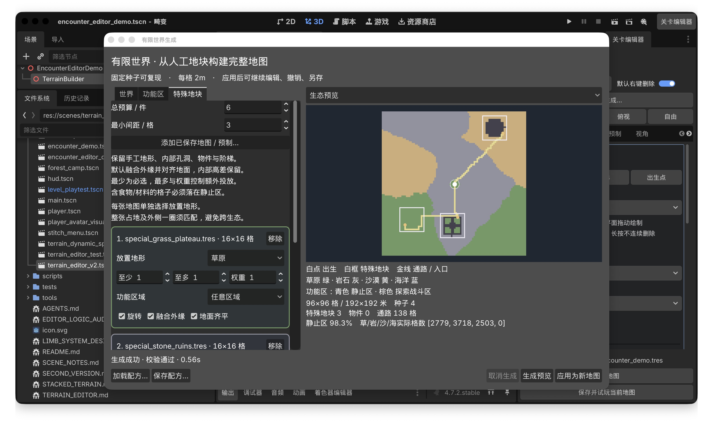
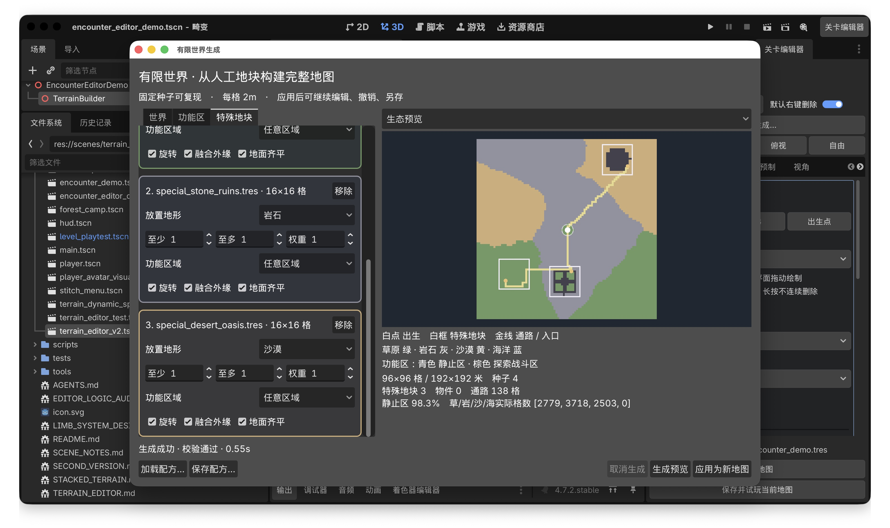

# 特殊地图地形选择验收

日期：2026-10-18；Godot 4.7.2；世界生成算法 v5。

## 交付行为

- 世界生成 → 特殊地块：每张导入地图独立显示彩色边框，框内包含文件名、尺寸、放置地形、数量、功能区域和原有拼接选项。
- 地形由用户逐张选择：草原绿、岩石灰、沙漠黄、海洋蓝。新导入地图显示“请选择地形”；旧配方缺字段时显示“不限制地形”。
- 原始世界的完整旋转后矩形占地（包含外缘留白）及外侧一格必须匹配所选生态。检查发生在地图和道路写入之前，不推测源地图生态、不把源地图内部地块改成所选地形。
- 找不到同时满足地形、区域、间距和入口的候选位置时：必选地图报错；可选地图跳过并提示所选地形。候选搜索沿用每份地图最多100次随机尝试，未找到不代表已穷举全部位置。
- 修改选择会禁用旧预览的应用；配方保存、重载保留每张地图的选择。固定视角物件的旋转选项在生成结束后仍保持禁用。
- 陆地入口保留周围地形类型；海洋道路仍转为可走的岩石通道。

## 自动化结果

| 套件 | 检查数 | 结果 |
| --- | ---: | --- |
| `tests/test_worldgen_terrain_selection.gd` | 46 | 通过 |
| `tests/test_world_generation.gd` | 32 | 通过 |
| `tests/test_worldgen_seams.gd` | 40 | 通过 |
| `tests/editor_world_generation_checks.gd` | 31 | 通过 |

覆盖四种地形落点、整片占地及外圈边界、旋转后的矩形、源地图保留、海洋道路、三张地图独立约束、缺少所选生态时的必选/可选行为、旧配方兼容、新地图未选择提示、保存重载、移除来源、取消、应用与真实编辑器撤销重做。项目导入和脚本解析无新增错误。

三地图混合示例使用96×96格、种子4：草原高台放草原、石板遗迹放岩石、沙地绿洲放沙漠，共3份，138格通路。该示例关闭自动物件散布，仅用于地形选择验收，原始源地图文件未修改。配方与结果在测试时保存至 `/tmp/worldgen-terrain-showcase-recipe.tres`、`/tmp/worldgen-terrain-showcase-map.tres`。

## 实际窗口

通过Metal打开真实Godot编辑器，实际生成预览成功，并核对文件名、尺寸、独立边框、地形选择、原有控制项和滚动列表没有横向裁切。





桌面工具读取Godot辅助功能状态时断连，截图由系统窗口截图取得；本次输入和保存/重载由编辑器自动化执行，未声称完成鼠标逐项点击验收。

## 重跑方式

```sh
../godot-engine/Godot.app/Contents/MacOS/Godot --headless --editor --path . --import
../godot-engine/Godot.app/Contents/MacOS/Godot --headless --path . --script tests/test_worldgen_terrain_selection.gd
../godot-engine/Godot.app/Contents/MacOS/Godot --headless --path . --script tests/test_world_generation.gd
../godot-engine/Godot.app/Contents/MacOS/Godot --headless --path . --script tests/test_worldgen_seams.gd
../godot-engine/Godot.app/Contents/MacOS/Godot --headless --editor --path . -- --test-worldgen-editor
```
